# Modelo Entidad-Relacion - Saberia

Version 3.0 - 29 entidades | Universidad de Cordoba - Desarrollo de Software II | Noviembre 2026

```mermaid
erDiagram
    %% ===== Identidad y control de acceso =====
    FACULTAD {
        int id_facultad PK
        varchar codigo UK
        varchar nombre
    }
    PROGRAMA {
        int id_programa PK
        int id_facultad FK
        varchar codigo UK
        varchar nombre
        varchar nivel
    }
    ROL {
        int id_rol PK
        varchar nombre UK
        varchar descripcion
    }
    USUARIO {
        int id_usuario PK
        varchar tipo_documento
        varchar num_documento UK
        varchar nombres
        varchar apellidos
        varchar correo UK
        varchar contrasena_hash
        int id_programa FK "NULL"
        int id_rol FK
        boolean estado
        timestamp fecha_registro
        timestamp ultimo_acceso
    }
    LOG_ACCIONES {
        int id_log PK
        int id_usuario FK
        varchar accion
        varchar entidad
        int id_entidad
        varchar valor_antes
        varchar valor_despues
        varchar ip_origen
        timestamp fecha
    }

    %% ===== Estructura academica =====
    PERFIL_DOCENTE {
        int id_docente PK
        int id_usuario FK "UK"
        varchar area
        varchar vinculacion
    }
    PERFIL_ESTUDIANTE {
        int id_perfil PK
        int id_usuario FK "UK"
        int id_grupo FK "NULL"
        int semestre
        decimal nivel_global "derivado"
        int puntos_totales "derivado"
        int racha_actual "derivado"
        int racha_maxima "derivado"
        timestamp fecha_actualizacion
    }
    PERIODO_ACADEMICO {
        int id_periodo PK
        varchar codigo UK
        date fecha_inicio
        date fecha_fin
        boolean activo
    }
    GRUPO {
        int id_grupo PK
        varchar codigo UK
        varchar nombre
        int id_docente FK
        int id_programa FK
        int id_periodo FK
        boolean estado
    }

    %% ===== Marco de contenidos Saber Pro =====
    MODULO {
        int id_modulo PK
        varchar codigo UK
        varchar nombre
        varchar descripcion
        varchar tipo
        boolean activo
    }
    COMPETENCIA {
        int id_competencia PK
        int id_modulo FK
        varchar codigo UK
        varchar nombre
        varchar descripcion
        boolean activo
    }
    AFIRMACION {
        int id_afirmacion PK
        int id_competencia FK
        varchar codigo
        varchar texto
        boolean activo
    }
    EVIDENCIA {
        int id_evidencia PK
        int id_afirmacion FK
        varchar codigo
        varchar descripcion
        boolean activo
    }
    PREGUNTA {
        int id_pregunta PK
        int id_evidencia FK
        int id_autor FK "NULL"
        text enunciado
        text contexto
        varchar tipo
        decimal dificultad
        int puntaje
        text justificacion
        varchar origen
        int version
        boolean activa
        timestamp fecha_creacion
    }
    OPCION {
        int id_opcion PK
        int id_pregunta FK
        varchar texto
        boolean es_correcta
        varchar retroalimentacion
        int orden
    }

    %% ===== Simulacros y respuestas =====
    SIMULACRO {
        int id_simulacro PK
        int id_creador FK
        int id_modulo FK "NULL = mixto"
        varchar nombre
        varchar descripcion
        varchar tipo
        int duracion_min
        int total_preguntas "derivado"
        varchar visibilidad
        boolean estado
        timestamp fecha_creacion
    }
    SIM_PREGUNTA {
        int id_sim_pregunta PK
        int id_simulacro FK
        int id_pregunta FK
        int orden
        decimal puntaje
    }
    ASIGNACION_SIMULACRO {
        int id_asignacion PK
        int id_grupo FK
        int id_simulacro FK
        timestamp fecha_apertura
        timestamp fecha_cierre
        int intentos_max
        boolean estado
    }
    SESION_SIM {
        int id_sesion PK
        int id_perfil FK
        int id_simulacro FK
        int id_asignacion FK "NULL = libre"
        int intento_num
        timestamp fecha_inicio
        timestamp fecha_fin
        varchar estado
        decimal puntaje_total "derivado"
        int tiempo_total_seg
    }
    RESPUESTA_SIM {
        int id_respuesta PK
        int id_sesion FK
        int id_sim_pregunta FK
        int id_opcion FK "NULL = en blanco"
        boolean es_correcta
        int tiempo_seg
        boolean marcada_revision
        timestamp fecha_respuesta
    }

    %% ===== Analitica y retroalimentacion =====
    REPORTE_GRUPO {
        int id_reporte PK
        int id_asignacion FK
        timestamp fecha_generacion
        decimal promedio_general
        int total_estudiantes
        decimal tasa_participacion
        text observaciones
    }
    DESEMPENO_COMPETENCIA {
        int id_desempeno PK
        int id_sesion FK
        int id_competencia FK
        int correctas
        int total_preguntas
        decimal porcentaje
        varchar nivel_logro
        timestamp fecha_generacion
    }
    RECURSO_APOYO {
        int id_recurso PK
        int id_competencia FK
        varchar titulo
        varchar tipo
        varchar url
        varchar descripcion
    }
    RETROALIMENTACION {
        int id_retro PK
        int id_desempeno FK
        int id_recurso FK "NULL"
        text mensaje
        text recomendacion
        varchar origen
        timestamp fecha
    }

    %% ===== Gamificacion =====
    CATALOGO_INSIGNIA {
        int id_badge PK
        varchar codigo UK
        varchar nombre
        varchar descripcion
        varchar icono
        varchar criterio
        int puntos_bonus
    }
    INSIGNIA_ESTUDIANTE {
        int id_insignia PK
        int id_perfil FK
        int id_badge FK
        timestamp fecha_obtenida
    }
    CATALOGO_RECOMPENSA {
        int id_item PK
        varchar nombre
        varchar descripcion
        int costo_puntos
        int stock
        boolean activo
    }
    CANJE_RECOMPENSA {
        int id_canje PK
        int id_perfil FK
        int id_item FK
        int puntos_gastados
        varchar estado
        timestamp fecha_canje
    }
    TRANSACCION_PUNTOS {
        int id_transaccion PK
        int id_perfil FK
        varchar tipo
        varchar concepto
        int puntos
        varchar origen_tipo
        int origen_id
        timestamp fecha
    }

    %% ===== Relaciones =====
    FACULTAD ||--o{ PROGRAMA : ofrece
    PROGRAMA |o--o{ USUARIO : agrupa
    ROL ||--o{ USUARIO : asigna
    USUARIO ||--o{ LOG_ACCIONES : registra
    USUARIO ||--o| PERFIL_DOCENTE : es
    USUARIO ||--o| PERFIL_ESTUDIANTE : es
    PERFIL_DOCENTE ||--o{ GRUPO : dirige
    PROGRAMA ||--o{ GRUPO : tiene
    PERIODO_ACADEMICO ||--o{ GRUPO : "se dicta"
    GRUPO |o--o{ PERFIL_ESTUDIANTE : matricula

    MODULO ||--o{ COMPETENCIA : tiene
    COMPETENCIA ||--o{ AFIRMACION : tiene
    AFIRMACION ||--o{ EVIDENCIA : tiene
    EVIDENCIA ||--o{ PREGUNTA : evalua
    USUARIO |o--o{ PREGUNTA : redacta
    PREGUNTA ||--o{ OPCION : tiene
    COMPETENCIA ||--o{ RECURSO_APOYO : apoya

    USUARIO ||--o{ SIMULACRO : crea
    MODULO |o--o{ SIMULACRO : define
    SIMULACRO ||--o{ SIM_PREGUNTA : contiene
    PREGUNTA ||--o{ SIM_PREGUNTA : "se usa en"
    GRUPO ||--o{ ASIGNACION_SIMULACRO : recibe
    SIMULACRO ||--o{ ASIGNACION_SIMULACRO : "se asigna"
    PERFIL_ESTUDIANTE ||--o{ SESION_SIM : presenta
    SIMULACRO ||--o{ SESION_SIM : genera
    ASIGNACION_SIMULACRO |o--o{ SESION_SIM : origina
    SESION_SIM ||--o{ RESPUESTA_SIM : incluye
    SIM_PREGUNTA ||--o{ RESPUESTA_SIM : responde
    OPCION |o--o{ RESPUESTA_SIM : selecciona

    ASIGNACION_SIMULACRO ||--o| REPORTE_GRUPO : resume
    SESION_SIM ||--o{ DESEMPENO_COMPETENCIA : produce
    COMPETENCIA ||--o{ DESEMPENO_COMPETENCIA : mide
    DESEMPENO_COMPETENCIA ||--o{ RETROALIMENTACION : genera
    RECURSO_APOYO |o--o{ RETROALIMENTACION : sugiere

    PERFIL_ESTUDIANTE ||--o{ TRANSACCION_PUNTOS : acumula
    PERFIL_ESTUDIANTE ||--o{ INSIGNIA_ESTUDIANTE : obtiene
    CATALOGO_INSIGNIA ||--o{ INSIGNIA_ESTUDIANTE : otorga
    PERFIL_ESTUDIANTE ||--o{ CANJE_RECOMPENSA : canjea
    CATALOGO_RECOMPENSA ||--o{ CANJE_RECOMPENSA : ofrece
```

## Cambios frente a la version 2

- Se elimino USUARIO_ROL: cada usuario tiene un solo rol (id_rol en USUARIO).
- Se elimino GRUPO_ESTUDIANTE: cada estudiante esta en un solo grupo (id_grupo en PERFIL_ESTUDIANTE).
- nivel_global de PERFIL_ESTUDIANTE pasa a DECIMAL(5,2) (rango 0.00 - 300.00).
- nivel_logro de DESEMPENO_COMPETENCIA: Nivel 1 a Nivel 4 (Ingles: -A1 a B2).

Convenciones: PK = clave primaria, FK = clave foranea, UK = unica. "derivado" = lo calcula el sistema.
